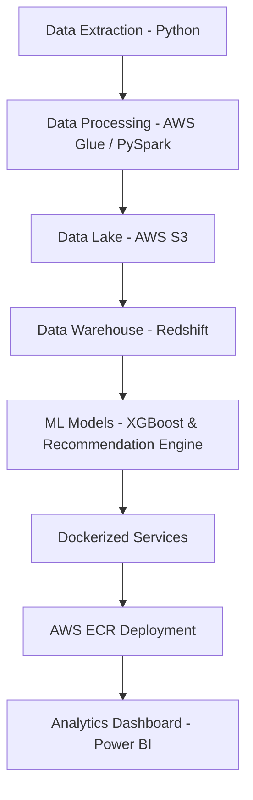

# 🏡 Airbnb Smart Data Platform  

### End-to-End Data + ML System for Pricing Optimization & Market Intelligence

---

## 📌 Overview

This project is a production-style data platform designed to help Airbnb hosts make data-driven pricing and expansion decisions.

It combines batch data processing, machine learning, and analytics dashboards to deliver:
- 📈 Price optimization
- 🧠 Recommendation systems
- 🌍 Market expansion insights

The system simulates a real-world data engineering + ML pipeline using cloud-native tools and containerized deployment.

---

## 🧱 Architecture

---

## ⚙️ Tech Stack

### 🧑‍💻 Programming
- Python, PySpark

### 🏗️ Data Engineering
- AWS Glue (Distributed Processing)
- Apache Airflow (Orchestration)
- AWS S3 (Data Lake)
- Amazon Redshift (Data Warehouse)

### 🤖 Machine Learning
- XGBoost (Price Prediction)
- Collaborative Filtering (Recommendations)

### 🚀 Deployment
- Docker
- AWS ECR

### 📊 Visualization
- Power BI Dashboard

---

## 🔄 Data Pipeline

### 1. Data Ingestion
- Collected Airbnb datasets via Python scripts
- Stored raw data in AWS S3 (data lake layer)

### 2. Data Processing (ETL)
- Used AWS Glue + PySpark for distributed data transformation
- Cleaned and standardized datasets for analytics and ML

### 3. Data Warehousing (ELT)
- Loaded processed data into Amazon Redshift
- Designed structured datasets for analytical queries

### 4. Machine Learning Layer
- Built XGBoost model for dynamic price prediction
- Developed recommendation engine for:
  - Amenity suggestions
  - Expansion opportunities

### 5. Orchestration
- Managed pipelines using Apache Airflow
- Automated scheduling, dependencies, and monitoring

### 6. Deployment
- Containerized services using Docker
- Deployed via AWS ECR, simulating production workflows

### 7. Visualization
- Built interactive Power BI dashboards for:
  - Pricing trends
  - Occupancy insights
  - Revenue analysis

---

## 📊 Key Features

- End-to-end ETL + ELT pipeline  
- Scalable distributed processing with AWS Glue  
- Machine learning integration for pricing intelligence  
- Recommendation engine for business decisions  
- Cloud-native architecture (S3 + Redshift)  
- Workflow orchestration using Airflow  
- Containerized deployment (Docker + ECR)  

---

## 📸 Dashboard Preview

### 📊 Analysis Page

### 💰 Price Optimization

### 🎯 Recommendation Engine

---

## 🧠 Key Learnings

- Designed a scalable data pipeline using AWS-native services  
- Implemented batch processing and ELT architecture  
- Integrated ML models into a data platform  
- Built end-to-end deployment workflows using Docker and ECR  
- Applied data modeling and transformation best practices  

---

## 🚀 Future Improvements

- Add real-time streaming (Kafka + Spark Streaming)  
- Migrate to Lakehouse architecture (Delta Lake / Iceberg)  
- Implement data quality framework (Great Expectations)  
- Add CI/CD pipeline for automated deployment  
